<!-- HEADER BANNER (self-hosted, never breaks) -->


<div align="center">

[](https://github.com/AyushSonewane/ayush-portfolio)
[](https://www.linkedin.com/in/ayush-sonewane)
[](https://leetcode.com/u/Ayush_Sonewane/)
[](mailto:sonewaneayush8320@gmail.com)

</div>

---

## 👨‍💻 About Me

> *I like turning ideas into software that people can actually install, use and enjoy.*

I'm an **MCA student from Nagpur** who builds cross-platform and full-stack applications. My main project, **[LocalShare](https://www.localshare.co.in/)**, is a real product: a Flutter file-sharing app for Android and Windows that is **live on the Microsoft Store**. I enjoy the parts of software that sit close to the metal, like sockets, device discovery and fast transfers, and I care just as much about interfaces that feel smooth and modern.

<div align="center">


</div>

### ⚡ What I do

<table>
  <tr>
    <td width="33%" valign="top" align="center">
      <h3>📱 Cross-Platform Apps</h3>
      <sub>Flutter and Dart apps that run on Android and Windows with one codebase and a polished UI.</sub>
    </td>
    <td width="33%" valign="top" align="center">
      <h3>🌐 Full-Stack Web</h3>
      <sub>Responsive frontends with HTML, CSS, JavaScript and React, backed by PHP and MySQL.</sub>
    </td>
    <td width="33%" valign="top" align="center">
      <h3>🔌 Real-Time Networking</h3>
      <sub>TCP socket communication, automatic device discovery and stable large-file transfers.</sub>
    </td>
  </tr>
</table>

### 🧬 Quick facts

```ts
const ayush: Developer = {
  name: "Ayush Sonewane",
  location: "Nagpur, India 📍",
  studying: "MCA @ G H Raisoni College of Engineering and Management (2025 – 2027)",
  shipped: "LocalShare, live on the Microsoft Store 🪟",
  strengths: ["Flutter", "Full-stack web", "Socket programming", "Problem solving"],
  speaks: ["English", "Hindi", "Marathi"],
  lookingFor: "Internships, collaborations and exciting project ideas 🚀",
};
```

- 🔭 **Currently:** building polished cross-platform and full-stack products
- 🧠 **Practicing:** problem solving on [LeetCode](https://leetcode.com/u/Ayush_Sonewane/)
- 🎓 **Studying:** MCA, currently in the 3rd semester
- 🤝 **Open to:** collaboration, internships and new challenges

---

## 🚀 Featured Projects

### 📲 [LocalShare](https://www.localshare.co.in/) &nbsp;`🟢 LIVE` `🪟 Available on Microsoft Store`
> Cross-platform file sharing between **Android and Windows** over a local Wi-Fi network. No internet, no cables.

- ⚡ Fast, reliable transfers using **TCP socket communication**
- 🔍 **Automatic device discovery** for seamless connectivity
- 🖱️ **Drag-and-drop** file sharing on the Windows app
- 📦 Optimized **large file transfers** with improved stability
- 🎨 Modern, responsive, user-friendly interface


[🌐 Visit Website](https://www.localshare.co.in/)

<br/>

### 🤝 HigherUp
> A startup networking and career platform connecting **Investors, Entrepreneurs and Job Seekers** in one ecosystem.

- 🔐 User authentication and profile management
- 🗄️ Secure MySQL storage for profiles, startup listings, investor info and jobs
- 🛠️ Full **CRUD** operations for users, startups and job listings
- 📱 Responsive UI built with HTML, CSS and JavaScript


<br/>

### 🎨 [Personal Portfolio](https://github.com/AyushSonewane/ayush-portfolio)
> An animated, dark-first developer portfolio showcasing my projects, skills and education.

---

## 🛠️ Tech Stack

**Languages**

       

**Frameworks & Libraries**

 

**Databases**

 

**Tools & Platforms**

   

**Soft Skills**

`Problem Solving` `Team Collaboration` `Communication` `Adaptability` `Quick Learning` `Time Management` `Leadership`

---

## 🎓 Education

| Degree | Institution | Duration | CGPA |
|:--|:--|:--:|:--:|
| **MCA** | G H Raisoni College of Engineering and Management, Nagpur | 2025 – 2027 | **9.14** |
| **BCCA** | J. M. Patel College of Arts, Commerce & Science, Bhandara (RTMNU) | 2022 – 2025 | **8.16** |

---

## 📫 Let's Connect

I'm open to internships, collaborations and exciting project ideas. Let's build something awesome together!

- 📧 **Email:** [sonewaneayush8320@gmail.com](mailto:sonewaneayush8320@gmail.com)
- 💼 **LinkedIn:** [ayush-sonewane](https://www.linkedin.com/in/ayush-sonewane)
- 🧩 **LeetCode:** [Ayush_Sonewane](https://leetcode.com/u/Ayush_Sonewane/)
- 📍 **Location:** Nagpur, Maharashtra, India

<br/>

<!-- FOOTER (self-hosted) -->

